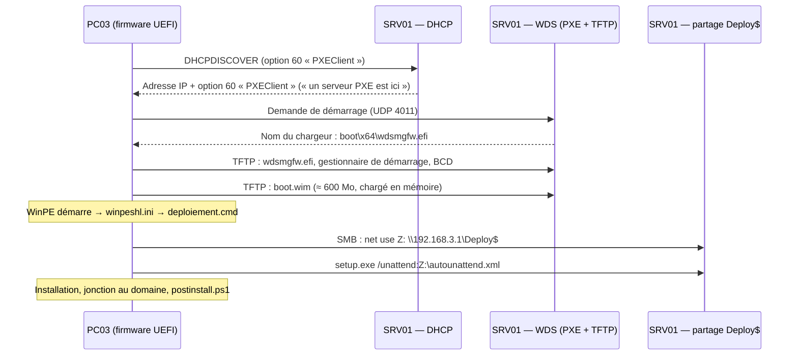

<nav class="chapter-resources" aria-label="Ressources du chapitre" data-course-key="windows11/17-wds-pxe"><div class="resource-buttons"><a class="resource-button" data-resource-kind="markdown" href="https://cours.kaya.ovh/windows11/windows11/17-wds-pxe/"><span class="resource-icon"><svg class="resource-symbol" aria-hidden="true" xmlns="http://www.w3.org/2000/svg" viewBox="0 0 32 24"><rect x="1" y="1" width="30" height="22" rx="3" fill="none" stroke="#34495e" stroke-width="2"/><path d="M5 18V6h3l4 5 4-5h3v12h-3v-7l-4 5-4-5v7Z" fill="#34495e"/><path d="M23 6h3v7h3l-4.5 5-4.5-5h3Z" fill="#34495e"/></svg>
</span><span class="resource-label">Cours</span></a><a class="resource-button" data-resource-kind="tp" href="https://cours.kaya.ovh/windows11/windows11/17-wds-pxe/tp"><span class="resource-icon"><svg class="resource-symbol" aria-hidden="true" xmlns="http://www.w3.org/2000/svg" viewBox="0 0 32 32"><rect x="2" y="4" width="28" height="24" rx="5" fill="#237b60"/><path d="m8 12 5 4-5 4m9 0h7" fill="none" stroke="#fff" stroke-width="2.5" stroke-linecap="round" stroke-linejoin="round"/></svg>
</span><span class="resource-label">TP</span></a></div><div class="resource-actions"><a class="resource-download" download href="https://cours.kaya.ovh/windows11/telechargements/windows11/cours/17-wds-pxe.md">↓ Télécharger le cours (.md)</a><button type="button" class="support-focus-toggle" aria-pressed="false">Masquer les menus</button></div></nav>

> [!NOTE] Objectif
> Faire de `SRV01` un **serveur de déploiement** : le poste démarre sur sa **carte réseau** (PXE), reçoit un WinPE servi par **WDS**, puis installe Windows 11 **sans clic** depuis un partage, avec le **même `autounattend.xml`** qu'au chapitre 16. Savoir ce que WDS fait encore en 2026, ce qu'il ne fait plus, et dépanner un démarrage PXE.
>
> **Outils :** rôle WDS (`wdsutil`, module PowerShell `WDS`), `Mount-WindowsImage`, `New-SmbShare`, console `WdsMgmt.msc`
> **Fichiers à connaître :** `boot.wim` (index 2), `winpeshl.ini`, `deploiement.cmd`, `autounattend.xml`, `sources\$OEM$`, `wdsmgfw.efi`

> [!INFO] Fil rouge — Fournil
> Le Fournil reçoit plusieurs postes neufs. Plutôt que de graver une clé par poste, `SRV01` devient serveur de déploiement : `PC03` démarre sur le réseau, s'installe, rejoint le domaine et reçoit ses applications.

> [!TIP] Prérequis
> Chapitre 16 fait : `autounattend-iso-officielle.xml` et `postinstall.ps1` fonctionnent avec l'ISO officielle. Ce chapitre ne change **que le transport** : réseau au lieu d'un DVD.

---

## 1. Le démarrage PXE, étape par étape




| Étape | Protocole | Port | Qui répond |
|-------|-----------|------|-----------|
| Obtenir une adresse | DHCP | UDP 67/68 | Service DHCP de `SRV01` |
| Trouver le serveur PXE | DHCP / PXE | UDP 67 ou **4011** | WDS |
| Télécharger le chargeur puis WinPE | **TFTP** | UDP 69 + ports dynamiques 64001-65000 | WDS |
| Lire les sources d'installation | **SMB** | TCP 445 | Partage `Deploy$` |

À retenir : **TFTP** est un protocole très simple (UDP, pas d'authentification), lent par défaut. Il ne transporte que le **démarrage** (WinPE). Les 6 Go de Windows passent ensuite par **SMB**.

---

## 2. WDS en 2026 : ce qui marche, ce qui ne marche plus

La console l'annonce dès l'ouverture : « *La fonctionnalité client des Services de déploiement Windows est partiellement déconseillée* ».


| Usage de WDS | État en 2026 | Constaté sur le lab |
|--------------|--------------|---------------------|
| **Servir un WinPE en PXE** (image de démarrage) | ✅ Supporté | Fonctionne (UEFI, Secure Boot) |
| Images d'**installation** Windows 11 dans WDS (`install.wim`) | ❌ Non supporté pour Windows 11 | `Import-WdsInstallImage` refuse le `install.wim` 26H2 : *Impossible de trouver une image d'installation* (`0xC104012B`) |
| Setup de Windows 11 en « **mode WDS** » (le `boot.wim` de l'ISO tel quel) | ❌ Déconseillé | Message de dépréciation, puis **redémarrage** en boucle |
| Fichier de réponse servi par WDS (*mains libres*) | ❌ Bloqué par défaut depuis **avril 2026** (CVE-2026-0386) | Non utilisé |
| Rôle WDS dans la **prochaine** version de Windows Server | ❌ Déprécié (KB5129631) | — |


> [!IMPORTANT] La méthode du cours
> On n'utilise WDS que pour ce qu'il fait encore bien : **PXE + TFTP**, pour livrer un WinPE. Ce WinPE lance un script qui ouvre le partage `Deploy$` et exécute `setup.exe /unattend` : c'est une installation **normale** de Windows, pilotée par le fichier de réponse du chapitre 16. WDS n'installe rien lui-même : aucune image d'installation, aucun fichier de réponse WDS.

C'est aussi la logique des outils qui remplacent WDS (Configuration Manager, FOG, WAPT…) : un démarrage réseau, puis un environnement qui applique Windows.

---

## 3. L'architecture sur SRV01

| Élément | Emplacement | Rôle |
|---------|-------------|------|
| Disque de données | `E:` (2e disque virtuel de 60 Go) | Hors du volume système, comme le recommande WDS |
| Dossier WDS | `E:\RemoteInstall` | Chargeurs, BCD, images de démarrage — géré par WDS, **on n'y touche pas à la main** |
| Partage `Deploy$` | `E:\Deploy` | Sources d'installation + fichier de réponse |
| ↳ `E:\Deploy\Windows11\` | contenu de l'ISO officielle | `setup.exe`, `sources\install.wim` |
| ↳ `E:\Deploy\autounattend.xml` | fichier de réponse | copie de celui du chapitre 16, nom `PC03` |
| ↳ `E:\Deploy\Windows11\sources\$OEM$\$$\Setup\Scripts\postinstall.ps1` | post-installation | copié par Setup dans `C:\Windows\Setup\Scripts` |
| Atelier WinPE | `E:\WinPE` | `boot.wim` en cours de personnalisation |
| Compte `svc.deploiement` | domaine | lecture seule sur `Deploy$` — son mot de passe est **dans** l'image de démarrage |

> [!NOTE] SRV01 est en Server Core
> Tout se fait en PowerShell et `wdsutil`, installés avec le rôle. La console graphique `WdsMgmt.msc` n'existe pas sur Server Core ni dans les RSAT de Windows 11 : les captures de console de ce chapitre montrent l'équivalent graphique sur un serveur avec Expérience de bureau. Sur le lab, chaque réglage est donné en ligne de commande.

---

## 4. Étape 1 — Préparer SRV01 et installer le rôle

```powershell
# Sur l'hôte Hyper-V : un 2e disque pour SRV01, et l'ISO officielle dans le lecteur DVD
New-VHD -Path D:\HyperV\SRV01\SRV01-data.vhdx -SizeBytes 60GB -Dynamic
Add-VMHardDiskDrive -VMName SRV01 -Path D:\HyperV\SRV01\SRV01-data.vhdx
Set-VMDvdDrive -VMName SRV01 -Path D:\ISO\Win11_26H2_French_x64.iso
```

```powershell
# Sur SRV01 : initialiser le disque en E:, puis installer le rôle
Get-Disk | Where-Object PartitionStyle -eq 'RAW' |
    Initialize-Disk -PartitionStyle GPT -PassThru |
    New-Partition -DriveLetter E -UseMaximumSize |
    Format-Volume -FileSystem NTFS -NewFileSystemLabel Deploiement

Install-WindowsFeature WDS -IncludeManagementTools
```

Le rôle comprend deux services : **Serveur de déploiement** (PXE, images) et **Serveur de transport** (multidiffusion). Les deux sont installés.

---

## 5. Étape 2 — Initialiser WDS et le faire cohabiter avec le DHCP

```powershell
wdsutil /Initialize-Server /RemInst:"E:\RemoteInstall"
```

WDS est **intégré à Active Directory** : `SRV01` étant contrôleur de domaine, aucune option supplémentaire n'est nécessaire.

> [!WARNING] Piège vécu : initialisation incomplète
> Sur le lab, `wdsutil /Initialize-Server` a renvoyé l'erreur **`0x41D`** (le service a mis trop de temps à démarrer). Le service a fini par démarrer, mais les fichiers de démarrage UEFI manquaient dans `E:\RemoteInstall\Boot\x64` : le poste affichait ensuite « *A boot image was not found* ». Vérification et correction :
> ```powershell
> Test-Path E:\RemoteInstall\Boot\x64\wdsmgfw.efi        # doit être True
> # Si False : recopier les fichiers fournis par le rôle, puis redémarrer le service
> Copy-Item C:\Windows\System32\RemInst\boot\x64\* E:\RemoteInstall\Boot\x64\ -Recurse -Force
> Restart-Service WDSServer
> ```

### DHCP et WDS sur le même serveur

Le DHCP et WDS veulent tous deux écouter le port **UDP 67**. Sur un même serveur, on dit à WDS de **ne pas** écouter ce port, et le DHCP ajoute l'**option 60** (« *PXEClient* ») pour indiquer aux postes qu'un serveur PXE les attend sur le port 4011.

```powershell
wdsutil /Set-Server /UseDhcpPorts:No /DhcpOption60:Yes
```


> [!TIP] DHCP sur un autre équipement *(approfondissement)*
> - **Routeur ou autre VLAN** : configurer un relais DHCP (*IP helper*) vers le DHCP **et** vers le serveur WDS.
> - **DHCP non Microsoft sur le même serveur** : cocher seulement « Ne pas écouter sur les ports DHCP » et créer l'option 60 à la main.
> - Les options **66/67** (serveur et fichier de démarrage) fonctionnent aussi, mais imposent un seul fichier pour tous les postes. Un parc qui mélange BIOS et UEFI ne démarre alors pas en entier.

### Répondre aux postes et démarrer sans touche

Par défaut, WDS ne répond à **aucun** poste, et un poste PXE demande d'appuyer sur **F12**. Pour un lab mains libres :

```powershell
wdsutil /Set-Server /AnswerClients:All
wdsutil /Set-Server /PxePromptPolicy /Known:NoPrompt /New:NoPrompt
```


> [!WARNING] « Toujours continuer » + « Répondre à tous » = danger en production
> Tout poste qui démarre sur le réseau (ordre de démarrage modifié, carte mère remplacée) **s'efface et se réinstalle**, car le fichier de réponse vide le disque 0. En entreprise : **F12 obligatoire**, ou réponse aux seuls clients **connus** (préinstallés dans l'AD), ou un VLAN de déploiement isolé.

---

## 6. Étape 3 — Accélérer TFTP

Avec les réglages par défaut, le chargement de `boot.wim` (≈ 600 Mo) a pris **7 minutes** sur le lab. Avec une taille de bloc de **16384** octets, il a pris **6 secondes**.

```powershell
$k = 'HKLM:\SYSTEM\CurrentControlSet\Services\WDSServer\Providers\WDSTFTP'
Set-ItemProperty $k -Name MaxBlockSize     -Value 16384 -Type DWord   # valeur testée sur le lab
Set-ItemProperty $k -Name MaximumBlockSize -Value 16384 -Type DWord   # valeur affichée par la console (onglet TFTP)
Restart-Service WDSServer
```


> [!NOTE] Pourquoi 16384 et pas plus ?
> Un bloc TFTP plus grand qu'une trame Ethernet (1500 octets) est **fragmenté** au niveau IP. Sur un réseau propre, cela passe et le gain est énorme. Si certains postes ou commutateurs perdent les fragments, le chargement échoue ou reste bloqué : on redescend alors à 8192, puis 4096.

---

## 7. Étape 4 — L'image de démarrage : le WinPE qui lance l'installation

On part du `boot.wim` de l'**ISO officielle**. Il contient deux images :

| Index | Nom | Contenu |
|-------|-----|---------|
| 1 | Microsoft Windows PE (amd64) | WinPE nu |
| 2 | Microsoft Windows Setup (amd64) | WinPE + Windows Setup — **c'est celui que WDS démarre** |

Laissé tel quel, l'index 2 lance Setup en « mode WDS », qui affiche l'avertissement de dépréciation puis redémarre (section 2). On ajoute un fichier **`winpeshl.ini`** : il remplace l'interface de démarrage de WinPE par **notre script**.

```ini
; Windows\System32\winpeshl.ini
[LaunchApps]
%SYSTEMROOT%\System32\cmd.exe, /k %SYSTEMROOT%\System32\deploiement.cmd
```

```bat
@echo off
rem Windows\System32\deploiement.cmd
wpeinit
wpeutil SetKeyboardLayout 040c:0000040c
echo  === Fournil : installation de Windows 11 depuis le partage de deploiement ===
wpeutil WaitForNetwork
ipconfig | find "IPv4"
net use Z: \\192.168.3.1\Deploy$ /user:FOURNIL\svc.deploiement Fournil2026!
if errorlevel 1 (echo Partage inaccessible : verifier le reseau et le compte. & goto :eof)
Z:\Windows11\setup.exe /unattend:Z:\autounattend.xml
echo setup.exe termine, code %errorlevel%
```

| Ligne | Rôle |
|-------|------|
| `wpeinit` | Initialise WinPE (réseau, pilotes). Avec un `winpeshl.ini`, il **n'est plus lancé automatiquement** |
| `wpeutil SetKeyboardLayout` | Clavier AZERTY dans WinPE |
| `wpeutil WaitForNetwork` | Attend que la carte réseau ait son adresse DHCP |
| `net use Z: …` | Ouvre le partage avec le compte de service |
| `setup.exe /unattend:` | Installation **classique** de Windows, pilotée par le fichier de réponse |
| `cmd.exe /k` | Garde l'invite ouverte : en cas d'échec, on lit le message et on peut taper des commandes |

Les deux fichiers sont fournis dans `Ressources/deploiement-wds/`. On les injecte dans l'**index 2**, **avant** l'import dans WDS :

```powershell
# Sur SRV01 (lecteur DVD = D:, ISO officielle)
New-Item E:\WinPE\mount -ItemType Directory -Force
Copy-Item D:\sources\boot.wim E:\WinPE\boot.wim
Set-ItemProperty E:\WinPE\boot.wim -Name IsReadOnly -Value $false     # copié d'un DVD : lecture seule

Mount-WindowsImage -ImagePath E:\WinPE\boot.wim -Index 2 -Path E:\WinPE\mount
Copy-Item .\deploiement.cmd, .\winpeshl.ini E:\WinPE\mount\Windows\System32\
Dismount-WindowsImage -Path E:\WinPE\mount -Save

Import-WdsBootImage -Path E:\WinPE\boot.wim -NewImageName 'WinPE Fournil - déploiement réseau'
Get-WdsBootImage | Select-Object Name, Architecture, FileName
```


Équivalent graphique : clic droit sur **Images de démarrage** → **Ajouter une image de démarrage…**, puis indiquer le fichier.


> [!WARNING] Piège vécu : modifier le mauvais index
> Sur le lab, la première tentative a modifié l'**index 1** : le poste démarrait toujours sur Setup en mode WDS. WDS démarre l'image **Windows Setup** (index 2). On vérifie avec `Get-WindowsImage -ImagePath E:\WinPE\boot.wim`.

> [!WARNING] Ne pas modifier les fichiers de `RemoteInstall` à la main
> Remplacer un `.wim` directement dans `E:\RemoteInstall\Boot\x64\Images` provoque une erreur de démarrage (`0xc0000098`, BCD incohérent). On modifie le `boot.wim` **avant** l'import. Pour changer une image déjà importée : `Remove-WdsBootImage`, puis nouvel import.

> [!TIP] Variante : WinPE de l'ADK *(approfondissement)*
> Le WinPE construit au chapitre 13 (`copype`) convient aussi, et c'est la voie que Microsoft documente pour WDS. On n'a pas besoin de `winpeshl.ini` : on ajoute les lignes de `deploiement.cmd` à la fin de `Windows\System32\startnet.cmd`, puis on importe `C:\WinPE_amd64\media\sources\boot.wim`.

---

## 8. Étape 5 — Le partage de déploiement

```powershell
# Compte de service : sait seulement lire le partage
New-ADUser svc.deploiement -Path 'OU=Fournil,DC=ad,DC=fournil,DC=lab' -Enabled $true `
    -AccountPassword (ConvertTo-SecureString 'Fournil2026!' -AsPlainText -Force) `
    -PasswordNeverExpires $true -CannotChangePassword $true

# Sources : contenu complet de l'ISO
robocopy D:\ E:\Deploy\Windows11 /E /NFL /NDL

# Fichier de réponse du chapitre 16, pour PC03
$xml = (Get-Content .\autounattend-iso-officielle.xml -Raw) -replace 'PC02', 'PC03'
Set-Content E:\Deploy\autounattend.xml $xml -Encoding UTF8

# Post-installation : $OEM$\$$ = C:\Windows sur le poste installé
New-Item 'E:\Deploy\Windows11\sources\$OEM$\$$\Setup\Scripts' -ItemType Directory -Force
Copy-Item .\postinstall.ps1 'E:\Deploy\Windows11\sources\$OEM$\$$\Setup\Scripts\'

New-SmbShare -Name 'Deploy$' -Path E:\Deploy -ReadAccess 'FOURNIL\svc.deploiement' -FullAccess 'FOURNIL\Admins du domaine'
```

| Point | Explication |
|-------|-------------|
| `-replace 'PC02','PC03'` | Le nom apparaît **deux** fois : `ComputerName` et `AutoLogon\Domain` (compte local, chapitre 16) |
| `$OEM$\$$` | Dossier spécial de Setup : son contenu est copié dans `%WINDIR%` du poste. `postinstall.ps1` arrive donc dans `C:\Windows\Setup\Scripts`, là où les `FirstLogonCommands` le cherchent (il n'y a plus de clé ni de DVD à la racine) |
| `'Deploy$'` | Entre apostrophes simples, sinon PowerShell prend `$` pour une variable. Le `$` final masque le partage dans le voisinage réseau |
| NTFS | Les droits NTFS par défaut de `E:\` donnent la lecture aux Utilisateurs authentifiés : `svc.deploiement` lit sans réglage de plus |

> [!WARNING] Mots de passe en clair
> Le mot de passe de `svc.deploiement` est **lisible dans l'image de démarrage**, et celui du compte de jonction est **lisible dans `autounattend.xml`** sur le partage. D'où un compte de service sans autre droit que la lecture. En production, on utilise aussi un compte délégué pour la jonction au domaine. `postinstall.ps1` supprime la copie du fichier de réponse laissée dans `C:\Windows\Panther`.

---

## 9. Étape 6 — Déployer PC03

```powershell
# Sur l'hôte : un poste neuf, sans DVD, qui démarre sur la carte réseau
New-VM -Name PC03 -Generation 2 -NewVHDPath D:\HyperV\PC03\PC03.vhdx -NewVHDSizeBytes 64GB `
    -SwitchName vSwitch-Rennes -Path D:\HyperV
Set-VMMemory PC03 -DynamicMemoryEnabled $false -StartupBytes 4GB; Set-VMProcessor PC03 -Count 2
Set-VMKeyProtector -VMName PC03 -NewLocalKeyProtector; Enable-VMTPM -VMName PC03
Set-VMFirmware PC03 -FirstBootDevice (Get-VMNetworkAdapter PC03)
Start-VM PC03; vmconnect.exe localhost PC03
```

Ce qu'on voit à l'écran :


La suite est identique au chapitre 16 : redémarrages, jonction au domaine, ouverture de session automatique `admin`, `postinstall.ps1` (Obsidian, VS Code), redémarrage final sur l'écran de connexion.

```powershell
# Vérifications (sur SRV01)
Get-ADComputer PC03 | Select-Object DistinguishedName      # OU=Ordinateurs,OU=Fournil
Resolve-DnsName PC03.ad.fournil.lab
Get-Content '\\PC03\C$\Windows\Temp\postinstall.log'
```

---

## 10. Dépannage du démarrage PXE

| Symptôme | Cause probable | Vérification / correction |
|----------|----------------|---------------------------|
| « *Start PXE over IPv4* » puis rien, retour au disque | Pas d'offre DHCP, ou pas d'option 60 | Étendue active ? poste sur `vSwitch-Rennes` ? `wdsutil /Get-Server /Show:Config` → *DHCP option 60* |
| « *A boot image was not found* » | WDS ne répond pas, ou fichiers UEFI absents | `AnswerClients:All` ? `wdsmgfw.efi` présent (section 5) ? service `WDSServer` démarré ? |
| Chargement de `boot.wim` très long | Taille de bloc TFTP par défaut | Section 6 |
| Message de dépréciation puis redémarrage en boucle | Setup en mode WDS : pas de `winpeshl.ini`, ou mauvais index modifié | Section 7 |
| « *Partage inaccessible* » dans la console WinPE | Compte, mot de passe, droits, réseau | Dans l'invite restée ouverte : `ipconfig`, `ping 192.168.3.1`, `net use` à la main |
| Setup s'arrête sur une question | Le fichier de réponse n'a pas été lu | `Z:\autounattend.xml` existe ? `X:\Windows\Panther\setupact.log` (Maj+F10) |
| Le poste se réinstalle à chaque démarrage | Carte réseau avant « Windows Boot Manager » dans l'ordre de démarrage + « Toujours continuer » | `Get-VMFirmware PC03` : en UEFI, Setup place normalement **Windows Boot Manager** en tête (constaté sur le lab). Sinon, remettre le disque en premier, ou exiger F12 |


> [!TIP] Les journaux côté serveur
> ```powershell
> # Erreurs : par exemple « Le serveur PXE a traité une demande émise par un client dont l'architecture est x64uefi. Aucune image… »
> Get-WinEvent -LogName 'Microsoft-Windows-Deployment-Services-Diagnostics/Admin' -MaxEvents 10
> # Détail des opérations (très bavard)
> Get-WinEvent -LogName 'Microsoft-Windows-Deployment-Services-Diagnostics/Operational' -MaxEvents 20
> ```
> Et pour relire la configuration complète : `wdsutil /Get-Server /Show:Config` (rubriques *Stratégie de réponse*, *Configuration DHCP*).

---

## Récapitulatif

> [!summary] L'essentiel du chapitre
> **Principe**
> - PXE = **DHCP** (adresse + option 60) → **TFTP** (chargeur + `boot.wim` en mémoire) → WinPE → **SMB** (sources d'installation)
> - WDS ne sert qu'à **PXE + TFTP** : en 2026, les images d'installation Windows 11 et le Setup en mode WDS ne sont plus pris en charge, le *mains libres* est bloqué (avril 2026), le rôle est déprécié dans le prochain Windows Server
>
> **Sur SRV01**
> - `Install-WindowsFeature WDS` · `wdsutil /Initialize-Server /RemInst:E:\RemoteInstall` (vérifier `wdsmgfw.efi`)
> - DHCP sur le même serveur : `/UseDhcpPorts:No /DhcpOption60:Yes`
> - `/AnswerClients:All` + `/PxePromptPolicy … NoPrompt` (lab uniquement)
> - TFTP : taille de bloc **16384** → `boot.wim` en 6 s au lieu de 7 min
>
> **L'image de démarrage**
> - `boot.wim` de l'ISO, **index 2** + `winpeshl.ini` → `deploiement.cmd` (`wpeinit`, `net use`, `setup.exe /unattend`)
> - Modifier **avant** `Import-WdsBootImage`, jamais dans `RemoteInstall`
>
> **Le partage `Deploy$`**
> - Contenu de l'ISO + `autounattend.xml` du chapitre 16 (`PC02` → `PC03`) + `sources\$OEM$\$$\Setup\Scripts\postinstall.ps1`
> - Compte `svc.deploiement` en lecture seule : son mot de passe est dans l'image
